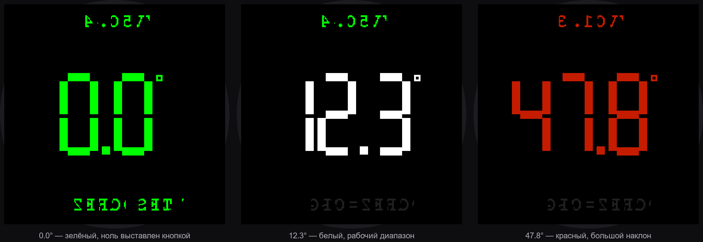

# Угломер на Waveshare RP2040-LCD-1.28

Цифровой угломер на круглом дисплее 240×240 (GC9A01). Показывает наклон в градусах
крупными семисегментными цифрами, кнопкой на GP0 обнуляется в текущем положении.
Дополнительно выводится напряжение батареи.



*Макет: отрисован тем же алгоритмом, что и `main.py`, и настоящим шрифтом `courier20`.*

Быстрые ссылки: [как прошить](docs/ПРОШИВКА.md) ·
[история проекта](HISTORY.md) · [план развития](ROADMAP.md) ·
[полная инструкция](docs/ИНСТРУКЦИЯ_RP2040_LCD_1.28.md)

## Железо

| Компонент | Что используется |
|---|---|
| Плата | Waveshare RP2040-LCD-1.28 (RP2040 + GC9A01 + QMI8658) |
| Дисплей | GC9A01, 240×240, SPI |
| Датчик | QMI8658 (акселерометр/гироскоп), I2C |
| Кнопка | Внешняя тактовая на **GP0** → **GND** (подтяжка внутренняя) |
| Питание | USB-C или LiPo (напряжение читается с GP29, делитель ×2) |

## Файлы

Всё, что лежит в корне репозитория, копируется в корень платы:

| Файл | Назначение |
|---|---|
| `main.py` | Программа угломера (наш код) |
| `lcd_driver.py` | Драйвер дисплея GC9A01 (от Waveshare) |
| `imu_qmi8658.py` | Драйвер IMU QMI8658 (от Waveshare) |
| `writer.py` | Вывод текста CWriter (от Waveshare) |
| `courier20.py` | Шрифт Courier 20 (от Waveshare) |
| `boolpalette.py` | Палитра для шрифта (от Waveshare) |

Остальное:

```
docs/      инструкция (md + pdf), ПРОШИВКА.md, макет интерфейса, схема пинов
firmware/  прошивка MicroPython для этой платы (.uf2)
dist/      uglomer-board-files.zip — те же 6 файлов одним архивом
tools/     make_release.py (собрать архив), make_screen_mockup.py (макет экрана)
legacy/    первая версия main.py (2026-05-08), для истории
```

## Прошивка платы

Делается один раз. Нужна **прошивка Waveshare**, официальная с micropython.org
не подойдёт — не будет работать дисплей.

1. Зажать **BOOT**, подключить USB → появится диск `RPI-RP2`.
2. Скопировать `firmware/RPI_PICO-20260406-v1.28.0.uf2` в корень диска.
3. Плата перезагрузится сама.

Подробно, со скриншотами шагов, проверками и таблицей проблем:
**[docs/ПРОШИВКА.md](docs/ПРОШИВКА.md)**

## Запуск

1. Открыть Thonny → **Инструменты → Параметры → Интерпретатор** →
   `MicroPython (Raspberry Pi Pico)`, выбрать COM-порт.
2. Залить 6 файлов на плату: распаковать `dist/uglomer-board-files.zip`
   и сохранить каждый через **Файл → Сохранить как → Raspberry Pi Pico**,
   имя не менять.
3. Открыть `main.py` с платы и нажать **F5**.

`main.py` на плате запускается автоматически при подаче питания.

## Управление

| Действие | Результат |
|---|---|
| Нажать кнопку на GP0 | Текущее положение принимается за 0°, на экране `ZERO SET!` |
| Отпустить | Показывается угол относительно нуля, `±0.0°…±180.0°` |

## Что на экране

Цвет цифр зависит от угла:

| Цвет | Угол |
|---|---|
| Зелёный | < 2° (почти ноль) |
| Белый | 2°–45° |
| Красный | > 45° |

Напряжение батареи (вверху):

| Цвет | Напряжение |
|---|---|
| Зелёный | > 3.5 В |
| Жёлтый | 3.2–3.5 В |
| Красный | < 3.2 В |

## Как считается угол

Акселерометр читается по X и Z, усредняется по 10 отсчётам (скользящее среднее),
угол = `atan2(ax, -az)` в градусах. Из результата вычитается значение, запомненное
по кнопке, с приведением к диапазону −180…+180.

## Работа с любого компьютера

Проект полностью в git — код, документация, прошивка и архив для платы.
На новой машине нужны только git и Thonny.

```
git clone https://github.com/permyakov344-png/uglomer.git
cd uglomer
```

Дальше — как обычно: открыть `main.py` в Thonny, залить на плату.
Ничего скачивать заново не нужно, `.uf2` лежит в `firmware/`.

Закончил работу — сохранить в GitHub:

```
git add -A
git commit -m "что изменил"
git pull --rebase
git push
```

Журнал изменений — `HISTORY.md`, новая запись сверху.

## Известные особенности

- PDF в `docs/` — старая сборка: эмодзи в нём отображаются квадратами.
  Актуальная версия инструкции — `docs/ИНСТРУКЦИЯ_RP2040_LCD_1.28.md`.
- Генератор PDF (`make_pdf.py`) в проекте отсутствует, его нужно восстанавливать.
- `docs/interfeys.png` и `docs/screens/*` — программный макет, а не фото
  реального экрана. Пересобрать: `python tools/make_screen_mockup.py`.
- Тестов нет: код выполняется только на железе под MicroPython.
